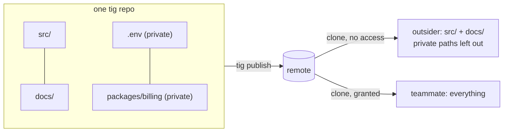
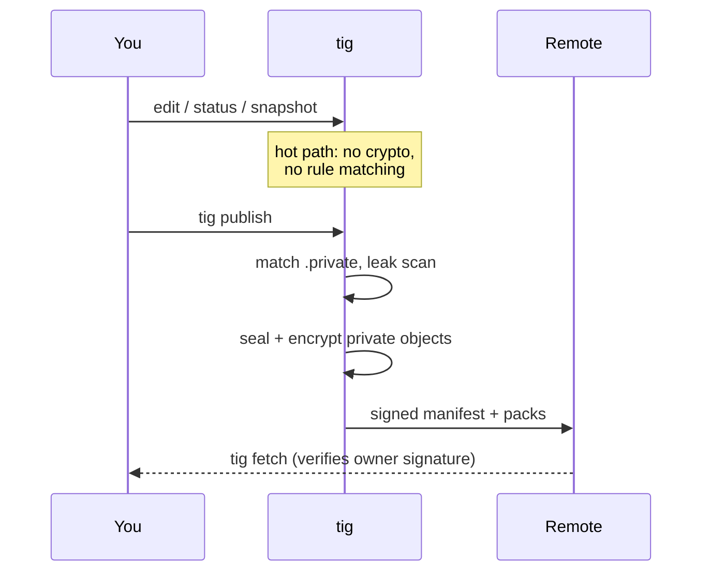
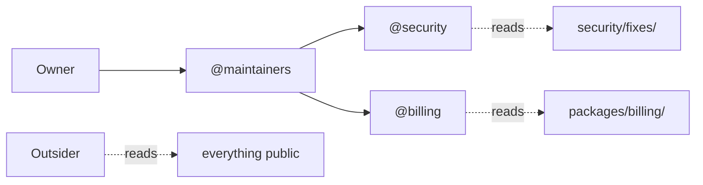
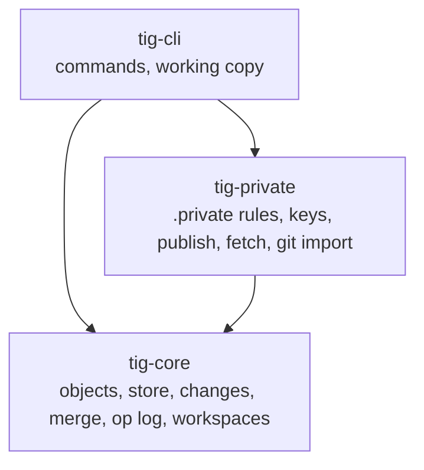

<div align="center">

# tig

**Version control where the repo is public, but your secrets aren't.**

Think Discord roles, but for your code: every path can have its own audience.

`.env`, private packages and unreleased fixes live in the same repo as everything else, and only the people you allow can read them.

  

</div>

> Not the [tig terminal UI for git](https://github.com/jonas/tig). This is a separate version control system, I am bad at names so for now this is tig.

---

## Why

Git permissions are all or nothing per repo. One secret file means a second repo, git-crypt, or hoping nobody commits `.env`.

tig flips it: **public by default, private per path.**



## What's different

| | git | tig |
|---|---|---|
| Private files in a public repo | separate repo or git-crypt | a `.private` file, like `.gitignore` |
| Staging and commits | manual, all the time | the working copy **is** a change, snapshotted automatically |
| Undo | reflog archaeology | every operation is undoable (`tig undo`, `tig op`) |
| Parallel checkouts | worktrees | workspaces: O(1) to create, same change in two places |
| Needs a real filesystem | yes | no, library first; the filesystem is just one client |

## Quick start

To develop this repository with TIG on Windows, follow the [GitHub-to-TIG setup](SELF_HOSTING.md#set-up-a-fresh-windows-workspace-from-github).

```sh
cargo build --release -p tig-cli

tig init
echo ".env" >> .private       # this path is now private
tig status                    # snapshots your edits, no `add` needed
tig describe -m "first change"
tig new                       # start the next change
tig undo                      # changed your mind? undo it
```

Coming from git:

```sh
tig import-git <path-to-git-repo>   # full history, flags anything that looks private
```

## How privacy works



**One rule beats every other rule:** nothing may add cost to edit, snapshot, status, diff, log or checkout. Permission checks, sealing and encryption run only at trust boundaries (publish, fetch, import, rule changes).

- Content addressed with **BLAKE3**
- Private objects encrypted with **XChaCha20-Poly1305**
- Per-reader key wrapping with **X25519** (like `age`), owner signatures with **Ed25519**
- Signed publish manifest, so a server can't hide or swap packs

**What outsiders can still see:** the `.private` file itself, change descriptions, author fields and bookmark names. Don't put secrets there; `tig publish` warns you if a private path shows up in them.

## Two modes: simple and advanced

**Simple mode** is just `.private`. List a path and it's private to everyone you grant access to. Most small projects never need more.

**Advanced mode** adds Discord-style roles. Tag a rule with `@role` and only that role can read it:

```gitignore
.env                      # simple: private group
packages/billing/ @billing
security/fixes/   @security @maintainers
```



Owners rank roles, and roles carry permissions like editing private paths, managing roles or approving merges. Going from simple to advanced mode is just adding tags to the same file, with no migration and no new repo.

> Roles are partly built: the `@role` syntax and per-role keys are in, and full end-to-end role grants are landing next.

## Architecture



About 27k lines of Rust. See [`DESIGN.md`](DESIGN.md) for the full design contract.

This repository now uses TIG locally. See [`SELF_HOSTING.md`](SELF_HOSTING.md) for compact status output, the privacy demo and the GitHub export bridge.

## Speed

Synthetic trees on Linux, median wall time, git on default settings:

| Operation | 100k files: git | 100k files: tig | tig / git |
|---|---:|---:|---:|
| init + first snapshot | 30,632 ms | 23,914 ms | 0.78x |
| status, no change | 1,694 ms | 1,179 ms | 0.70x |
| status, 1 file edited | 1,687 ms | 1,234 ms | 0.73x |
| record change | 1,630 ms | 1,081 ms | 0.66x |

Methodology, Windows numbers and caveats are in [`bench/RESULTS.md`](bench/RESULTS.md). Comparisons against tuned git and jj are next.

## Status

| Done | Next |
|---|---|
| core engine, changes, undo, workspaces | export back to git |
| `.private` simple mode | Discord-style roles end to end |
| publish and fetch with crash recovery | GitHub integration |
| git import with full history | security audit |

**Alpha and unaudited.** Please try to break it. See [`SECURITY_REVIEW.md`](SECURITY_REVIEW.md) and open an issue.

## License

Dual-licensed under MIT or Apache-2.0, at your option.
