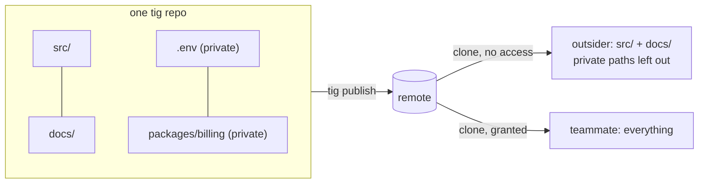
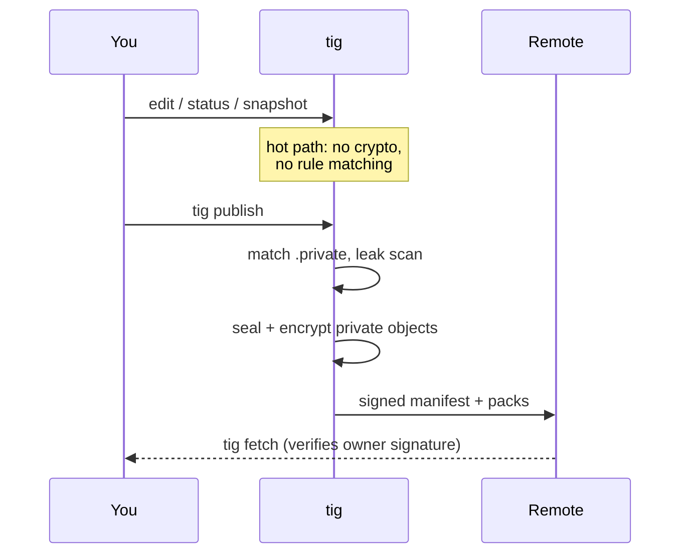
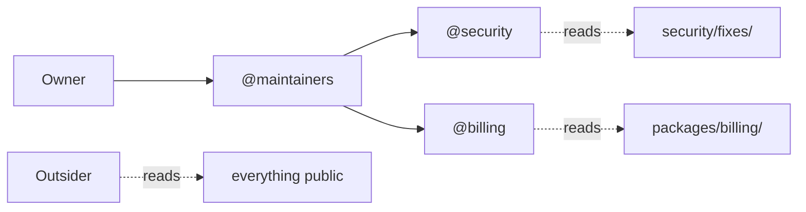
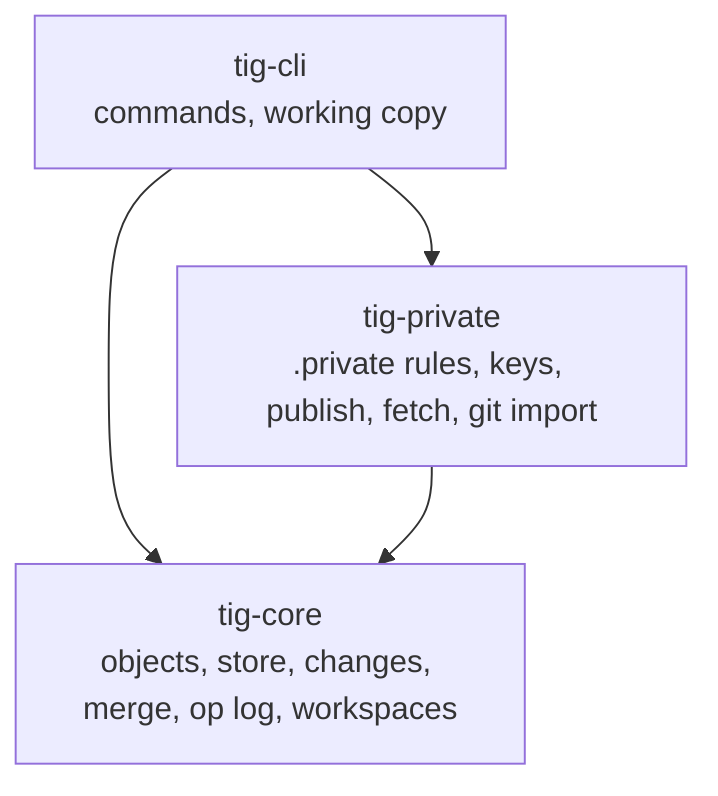

<div align="center">

# tig

**Version control where the repo is public, but your secrets aren't.**

Think Discord roles, but for your code: every path can have its own audience.

`.env`, private packages and unreleased fixes live in the same repo as everything else, and only the people you allow can read them.

  

</div>

> Not the [tig terminal UI for git](https://github.com/jonas/tig). This is a separate version control system, I am bad at names so for now this is tig.

---

## Why

Git permissions are all or nothing per repo. One secret file means a second repo, git-crypt, or hoping nobody commits `.env`.

tig flips it: **public by default, private per path.**



## What's different

| | git | tig |
|---|---|---|
| Private files in a public repo | separate repo or git-crypt | a `.private` file, like `.gitignore` |
| Staging and commits | manual, all the time | the working copy **is** a change, snapshotted automatically |
| Undo | reflog archaeology | every operation is undoable (`tig undo`, `tig op`) |
| Parallel checkouts | worktrees | workspaces: O(1) to create, same change in two places |
| Needs a real filesystem | yes | no, library first; the filesystem is just one client |

## Quick start

To develop this repository with TIG on Windows, follow the [GitHub-to-TIG setup](docs/development.md#set-up-a-fresh-windows-workspace-from-github).

```sh
cargo install --locked --path crates/tig-cli

tig init
echo ".env" >> .private       # this path is now private
tig status                    # snapshots your edits, no `add` needed
tig describe -m "first change"
tig new                       # start the next change
tig undo                      # changed your mind? undo it
```

Run the install command from this checkout with Rust installed. It installs the CLI in Cargo's binary directory. If your system already has another `tig`, use the executable path printed by `cargo install`.

Coming from git:

```sh
tig import-git <path-to-git-repo>   # full history, flags anything that looks private
```

## How privacy works



**One rule beats every other rule:** nothing may add cost to edit, snapshot, status, diff, log or checkout. Permission checks, sealing and encryption run only at trust boundaries (publish, fetch, import, rule changes).

- Content addressed with **BLAKE3**
- Private objects encrypted with **XChaCha20-Poly1305**
- Per-reader key wrapping with **X25519** (like `age`), owner signatures with **Ed25519**
- Signed publish manifest, so a server can't hide or swap packs

**What outsiders can still see:** the `.private` file itself, change descriptions, author fields and bookmark names. Don't put secrets there; `tig publish` warns you if a private path shows up in them.

## Two modes: simple and advanced

**Simple mode** is just `.private`. List a path and it's private to everyone you grant access to. Most small projects never need more.

**Advanced mode** adds Discord-style roles. Tag a rule with `@role` and only that role can read it:

```gitignore
.env                      # simple: private group
packages/billing/ @billing
security/fixes/   @security @maintainers
```



Owners rank roles and grant `edit-private`, `manage-roles`, `assign-roles` and `publish` permissions. Managers can delegate only permissions they hold to lower-ranked roles. Adding tags activates role mode while preserving existing simple-mode members' access.

```sh
tig role create billing --rank 1
tig role grant billing READER_TOKEN
tig role revoke billing READER_TOKEN   # removes access and rotates keys
```

Role creation, grants, revocation, literal command environments and ownership transfer are implemented. See the [role guide](docs/guide.md#roles-and-command-environments) for the commands and the separation between management permission and secret-key custody.

## Architecture



See [`DESIGN.md`](DESIGN.md) for the full design contract.

## Speed

Real-source Windows comparisons include wins and losses: TIG is faster for clean Gitoxide status and a tracked ignored-file edit, but slower for its README edit and for edited TypeScript status. TIG status also records edits, while Git status only reports them. Frozen binary IDs, methods and retained samples are in [`bench/RESULTS.md`](bench/RESULTS.md).

## Documentation

- [User guide](docs/guide.md): roles, conflicts, Git import/export, private changes and large files.
- [Design](DESIGN.md): architecture, wire formats and known limits.
- [Security](SECURITY.md): identity protection and key storage.
- [Development](docs/development.md): build, test and work on TIG with TIG.

## Status

Implemented: changes, undo, workspaces, stored conflicts, per-path privacy, roles, directory/HTTPS remotes, Git history import, public Git export and a reproducible GitHub-to-TIG local setup.

**Alpha and unaudited.** First-contact trust, previously disclosed secrets and filesystem crash/race limits still matter. See [`DESIGN.md`](DESIGN.md#known-gaps-tracked-not-forgotten) and [`SECURITY.md`](SECURITY.md). Sharing unresolved conflicts, server-side garbage collection and operation-history transfer remain deferred.

## License

Dual-licensed under MIT or Apache-2.0, at your option.
